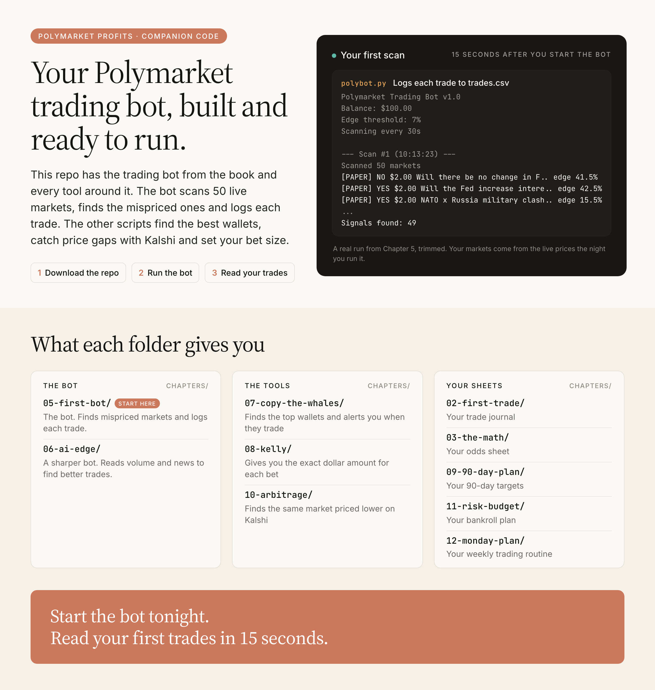

# polymarket-profits

**A paper-trading bot for your laptop. It reads live Polymarket prices, prices every market after the taker fee, sizes each trade with fractional Kelly and logs it to `trades.csv`. Plus the journal, Kelly sheet and tracker you use with it.**

The companion code to the book *Polymarket Profits: Build AI Trading Bots in a Weekend*, from [youcanbuildthings.com](https://youcanbuildthings.com).

[](https://github.com/regardo911/polymarket-profits/actions/workflows/ci.yml)
[](LICENSE)
[](DISCLAIMER.md)



In plain English: Polymarket publishes its prices for free. A short Python script can read every busy market, compare each price with its own estimate of the odds, and write down the bets it would place. No money moves. Two words show up straight away. *Paper trade* means a bet that is only written down; `chapters/05-first-bot` makes them. *Edge* is the gap between your estimate and the price, and `chapters/03-the-math` is the sheet where you work it out by hand first. Pick your line below.

## Start here

### I want to watch the bot trade on paper tonight

Most readers start here. No key, no account, about five minutes. You need Python 3.11 or newer (`python3 --version`; the Python that ships with macOS is 3.9, too old) and an internet connection.

```bash
git clone https://github.com/regardo911/polymarket-profits.git
cd polymarket-profits
python3 -m venv .venv
source .venv/bin/activate          # Windows: .venv\Scripts\activate
pip install requests python-dotenv
cd chapters/05-first-bot
python3 polybot.py
```

The first scan took about 15 seconds in a test run. Its output (your markets and numbers will differ):

```text
==================================================
Polymarket Trading Bot v1.0
Mode: PAPER
Balance: $100.00
Edge threshold: 7%
Max position: $5.00
Scanning every 30s
==================================================

--- Scan #1 (21:11:06) ---
Scanned 59 markets
[PAPER] NO $2.00 Will there be no change in F.. edge 43.5%
[PAPER] YES $2.00 Will the Fed increase intere.. edge 43.5%
...
Signals found: 37
Already traded: 37 markets
```

Every `[PAPER]` line is now a row in `chapters/05-first-bot/trades.csv`. Stop it with Ctrl+C. Almost every busy market gets flagged because the Chapter 5 bot compares each price with a coin flip; that's the dumb brain [Chapter 6](chapters/06-ai-edge) replaces.

### I'm about to place a trade and want the size

```bash
python3 chapters/08-kelly/kelly.py --prob 0.55 --price 0.50 --fee-rate 0.07 --bankroll 1000
```

Your probability, the Yes price, the market's fee rate and your bankroll in; full, half and quarter Kelly out, with the 5% cap applied. [Chapter 8's folder](chapters/08-kelly) has the spreadsheet version.

### I finished the book and want the files

Go to the [copy table](#copy-table). Every row is one chapter's files and where they go.

### I'm ready to send a real order

Read [`chapters/05-first-bot/live/`](chapters/05-first-bot/live) first. It places one limit order through Polymarket's own SDK, and it stays a dry run until you switch it on in code.

## Copy table

| Chapter | In this repo | Where it goes in your setup |
|---|---|---|
| 2, 4 | [`trade-journal.md`](chapters/02-first-trade/trade-journal.md) | A spreadsheet tab, a notes page or a text file. One block per trade; Chapter 4 adds seven lines |
| 3 | [`calibration-and-ev-sheet.md`](chapters/03-the-math/calibration-and-ev-sheet.md) | Print it or copy it into your journal |
| 5 | [`polybot.py`](chapters/05-first-bot/polybot.py) | Your `polybot/` folder, next to `.venv` |
| 5 | [`live/`](chapters/05-first-bot/live) | Only when you go live: a `live/` folder beside the bot, with your own `.env` |
| 6 | [`polybot.py`](chapters/06-ai-edge/polybot.py), [`record.py`](chapters/06-ai-edge/record.py), [`.env.example`](chapters/06-ai-edge/.env.example) | Replace your `polybot.py`; keep your `trades.csv` and `traded_markets.json` |
| 7 | [`whales.py`](chapters/07-copy-the-whales/whales.py), [`alerts.py`](chapters/07-copy-the-whales/alerts.py) | Same folder as the bot, same venv |
| 8 | [`polybot.py`](chapters/08-kelly/polybot.py), [`kelly.py`](chapters/08-kelly/kelly.py), [`kelly-sheet.csv`](chapters/08-kelly/kelly-sheet.csv) | Bot and calculator into your folder; import the CSV into Google Sheets or Excel |
| 9 | [`90-day-plan.md`](chapters/09-90-day-plan/90-day-plan.md) | Fill it in, sign it |
| 10 | [`arb.py`](chapters/10-arbitrage/arb.py), [`portfolio-tracker.csv`](chapters/10-arbitrage/portfolio-tracker.csv) | Script into your folder; CSV into your spreadsheet app |
| 11 | [`risk-budget.md`](chapters/11-risk-budget/risk-budget.md) | One signed page, pinned where you trade |
| 12 | [`weekly-routine.md`](chapters/12-monday-plan/weekly-routine.md) | Your calendar, as recurring events |

## Chapter map

| Chapter | What you build | The command | What success looks like |
|---|---|---|---|
| 1 | Nothing to build; it's the why | | |
| 2 | First trade and a journal | `curl https://polymarket.com/api/geoblock` | A funded account where it's legal for you, one journal entry |
| 3 | Your bias and three priced markets | by hand | Five estimates scored, three markets marked TRADE or SKIP |
| 4 | First strategy trade, in the same journal | by hand | A 5+ point edge, fee-adjusted EV, full thesis in the journal |
| 5 | The paper-trading bot | `python3 polybot.py` | `Scanned` above zero on every scan, rows landing in `trades.csv` |
| 6 | Volume, headlines, calibrated baselines | `python3 record.py crypto no` | 3 scans with no errors; `recorded crypto: no` |
| 7 | Wallet vetting and alerts | `python3 whales.py` | Five rows with trades, win rate and profit without the best win |
| 8 | Kelly sizing for you and the bot | `python3 kelly.py --prob 0.55 --price 0.50` | `Full Kelly 10.0%`; the bot's new rows sized by Kelly, most at the $5.00 paper cap |
| 9 | Your 90-day plan | by hand | Path, monthly targets at 8-12%, weekly milestones, kill switch |
| 10 | Arbitrage scanner and tracker | `python3 arb.py` | `Polymarket N \| Kalshi N \| candidates N`; zero candidates is normal |
| 11 | Risk budget | by hand | Every number written, current positions inside your caps |
| 12 | Weekly routine | by hand | Routine and 90-day checkpoint on your calendar |

## Architecture

The bot is four jobs in one loop: a Data Watcher reads prices, an Analyst decides whether there's edge after the fee, a Trader sizes the position, and a Logger writes it down. Chapters 6 and 8 swap out the Analyst's brain and the Trader's sizing, and add helpers around them. The loop barely moves: in Chapter 6, `run_bot` just calls `analyze_market_v2`. Diff Chapter 5 against Chapter 8 to see what each chapter added.


## What it needs to run

- Python 3.11 or newer, `requests` and `python-dotenv` ([`requirements.txt`](requirements.txt)). Everything else is the standard library.
- An internet connection for the bot, `whales.py`, `alerts.py` and `arb.py`. They read Polymarket's and Kalshi's free public data; none of them needs a key or an account, from any country.
- A spreadsheet app for the two CSV sheets. Their formula cells start with `=`; in Google Sheets, tick "Convert text to numbers, dates, and formulas" when you import.
- Optional: a free NewsAPI key in `chapters/06-ai-edge/.env` for headlines, and your own LLM call in `call_llm_api`.

`live_order.py` is the one file that needs your own Polymarket or Polymarket US account and API credentials. Everything else runs before you've opened an account, so you can paper-trade for a month first.

## Going live

The book's ladder, from Chapter 9's Bot Operator path:

1. **Month 1, paper only.** Run the bot 24/7. Go live only if the paper trades show a profit after fees across 200+ resolved trades. Judge by profit, not win rate.
2. **Test the order path** with one small order through `live_order.py`.
3. **Month 2, training wheels.** Quarter Kelly, at most $50 a trade, at most 10 trades a day, 20% of the bankroll in cash.
4. **Month 3**, only if month 2 matched paper: half Kelly, 5% cap per market, keep the 20% cash.

Every live order needs the code-level opt-in: you uncomment `set_live_mode(True, confirm="I_HAVE_REVIEWED_THIS")` in `live_order.py`. No command-line flag or environment variable does it. Don't paste a private key into any file you might commit; `.env` is in `.gitignore` for that reason, and bots scan public GitHub for exposed keys.

## Configuration

None of it is required. The tunables sit at the top of each `polybot.py`, under the names the book uses: `EDGE_THRESHOLD` (0.07), `MIN_VOLUME` (10000), `MAX_SPREAD` (0.08), `SCAN_INTERVAL` (30), and in Chapter 8 `KELLY_FRACTION` (0.25) and `MAX_BET` (0.05). Raise `MIN_VOLUME` if the bot is noisy. Don't lower `EDGE_THRESHOLD` to get more signals; that's how you lose money faster.

The places where the printed book doesn't run as written, and what this repo does instead, are in [BOOK-FIXES.md](BOOK-FIXES.md).

## Contributing

Fixes welcome, especially when Polymarket or Kalshi change an endpoint. Every file maps to a chapter and keeps the book's names, so a reader who followed along recognises what they copy; please keep it that way. See [CONTRIBUTING.md](CONTRIBUTING.md).

## License

MIT, see [LICENSE](LICENSE).

Educational software, provided as-is, not financial advice. Not affiliated with Polymarket or Kalshi. Prediction markets can lose you all the money you put in.
